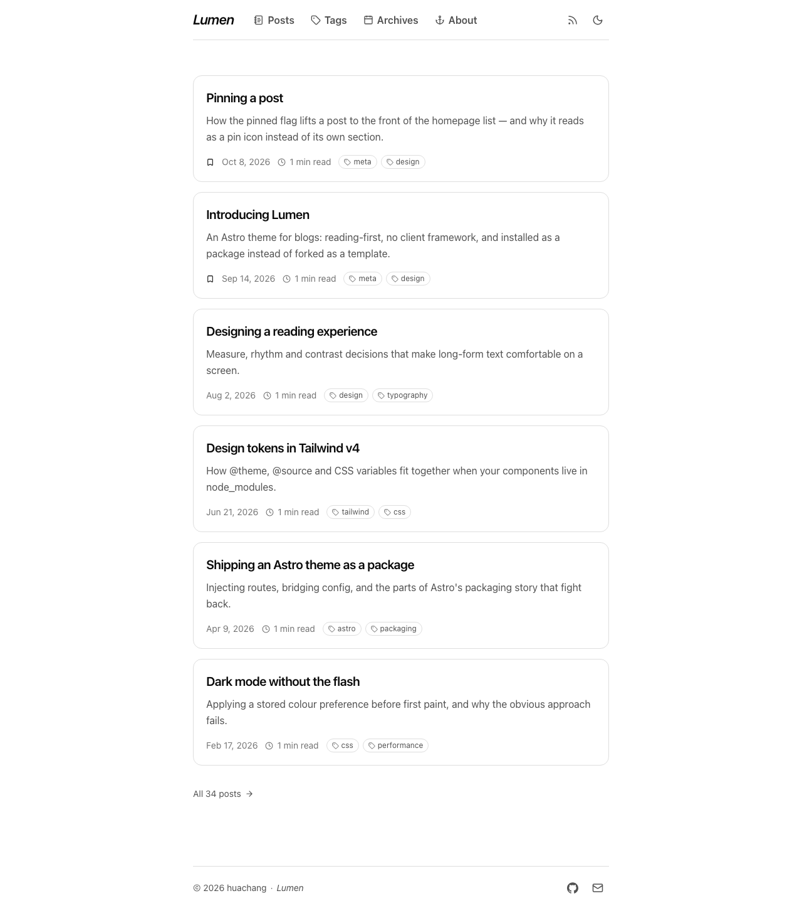
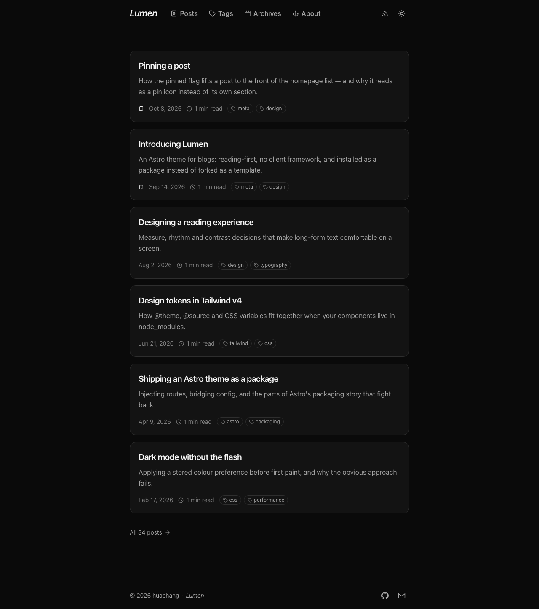

# astro-theme-lumen

A pnpm workspace for developing and publishing the **Lumen** Astro theme — a
blog theme, installed as a package rather than forked as a template.

Lumen is built for reading, and costs almost nothing to load.

| Homepage, light | Homepage, dark |
| --- | --- |
|  |  |

## Layout

```
.
├── packages/astro-theme-lumen/   # the published npm package
└── demo/                         # a site consuming it via workspace:*
```

## Working on the theme

```bash
pnpm install
pnpm dev        # start the demo dev server
pnpm build      # production build of the demo
pnpm check      # type-check the demo and the theme sources
pnpm theme:pack # produce the publishable tarball
```

Changes go in `packages/astro-theme-lumen`. The demo links to it with
`workspace:*`, so edits are picked up without reinstalling.

`pnpm check` type-checks the theme sources as well as the demo — the demo's
`tsconfig.json` includes `../packages/astro-theme-lumen`, which is the only way
to get `astro check` to look at `.astro` files that live outside the project.

## Verifying a release

A workspace symlink does not exercise the path a real user takes, so install the
tarball somewhere outside this repo before publishing:

```bash
pnpm theme:pack
mkdir -p /tmp/lumen-check && cd /tmp/lumen-check
npm init -y
npm install astro @tailwindcss/vite tailwindcss /path/to/astro-theme-lumen-0.1.0.tgz
```

> If you re-pack the same version, clear `package-lock.json` and `node_modules`
> first. npm pins the old tarball's integrity in the lockfile and will happily
> reinstall the previous build otherwise.

## Publishing

```bash
pnpm theme:pack          # inspect the tarball first
cd packages/astro-theme-lumen && npm publish
```

The package ships TypeScript and `.astro` sources directly — Astro and Vite
compile them in the consumer's build, so there is no build step to keep in sync.
The tarball is 41 files, about 30 KB.

See [the theme README](packages/astro-theme-lumen/README.md) for the full
configuration reference.
